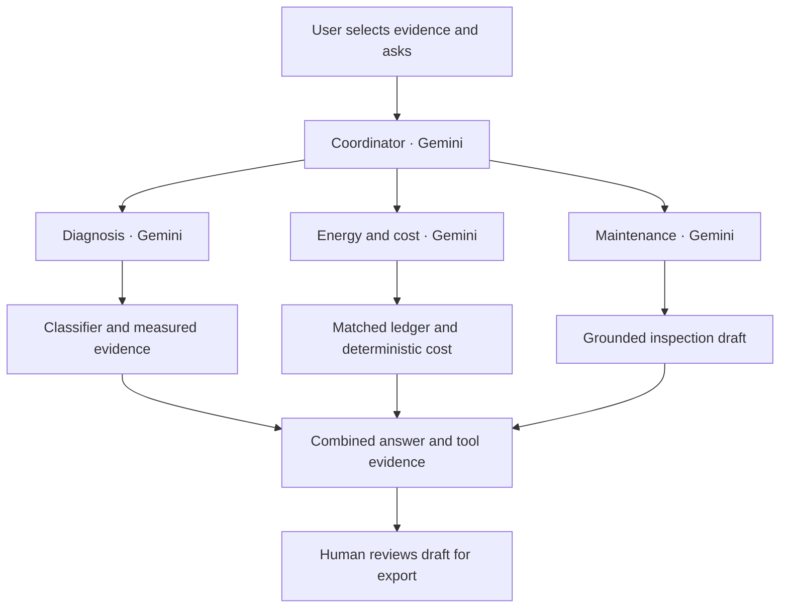

# Four-agent architecture

These are four **logical LLM agents** in the application, not four separately trained models or cloud services. Each has a distinct role, system prompt, tool allowlist and Gemini conversation. All share the configured Vertex Gemini model and Cloud Run runtime. This implementation uses the Google Gen AI SDK directly, not Google ADK or Agent Engine.

| Agent | Allowed tools | Evidence / result |
|---|---|---|
| Coordinator | ask_diagnosis, ask_energy, ask_maintenance | Delegates and synthesizes specialist responses |
| Diagnosis | inspect_measurement | Server-computed leakage prediction, descriptive sensor evidence and nearest training cases |
| Energy & cost | compare_energy, calculate_cost | Real retrospective matched comparison and deterministic cost calculation from explicit form inputs |
| Maintenance | draft_work_order | Evidence-linked inspection draft, verification checklist and review fields |

The coordinator selects specialists through Gemini function calls. Full-investigation mode requires all three specialists, once each. Follow-ups permit selective delegation. Specialists must call their evidence tools before responding. The energy agent first gets the comparison; supplied cost assumptions require the calculation tool too. If a provider ignores the required tool protocol, the request fails explicitly instead of presenting a fabricated success.



## Grounding boundaries

- Diagnosis uses the original model and data. The current cycle's ground-truth annotations are removed from its evidence tool. Similar training examples carry their known labels.
- Recorded energy comparisons use recorded cooler, valve and accumulator annotations to select a matched setting. This is explicitly retrospective analysis, separate from predicting the selected cycle's leakage class.
- Uploaded sensor metadata and supplied labels are ignored for classification. The user must explicitly select a ledger setting for an uploaded cycle's comparison; this choice is not inferred as compatible with the upload.
- A cost scenario requires tariff (INR/kWh), hours/day, days/year and a weak/severe leakage comparison selected in the UI. Model arguments cannot override these values. Costs are recomputed by Python and are illustrative, not validated factory savings.
- The maintenance draft is constructed from the measured report and verification checklist, not unverified user instructions or generated causal conclusions.
- LLM prose can still be inaccurate. Original tool outputs are available beside it so the engineer can verify every numeric claim.

## Runtime limits and errors

`app/agents/runtime.py` owns manual function declarations, tool dispatch and function responses. Preserve the model's function-call content in history; this also preserves any thought signatures required by compatible models. Each specialist may call each allowed tool once per request. Unknown tools, model-supplied calculation arguments and repeated tool requests fail closed.

A request allows at most 12 model calls, a 70-second wall-clock budget checked before every call, and up to 20 seconds timeout per model call using the remaining deadline. SDK retries are disabled (`attempts=1`). A slow provider can exhaust the budget; ask a narrower question or retry. This is a bounded synchronous research demo, not a durable background job system. Gunicorn and Cloud Run timeouts are 90 seconds. Two AI requests can execute concurrently; additional requests return 429.

Missing config: 503. Invalid evidence/inputs: 400. Provider/tool protocol/budget failure: 502. No offline canned agent responses. Local model and recorded replay continue to work without GCP.

The response includes a run ID, elapsed time, model call count, agent results, ordered tool execution events and a structured draft when the maintenance tool ran. The UI displays completed events after the HTTP response, not a live stream. The log contains tool actions and evidence, not private chain-of-thought.

Conversation history (last eight user/assistant text messages) lives in the browser tab and is supplied as untrusted context. Every request gets fresh server-owned evidence. Changing source or scenario inputs resets history and invalidates stale responses. No database or durable chat/session storage is included. Export the investigation JSON to keep an audit record.

## Human review

A checkbox acknowledges review **for export only**. It is not authenticated engineer approval. The reviewed draft can be downloaded as JSON; nothing is sent to a CMMS, assigned to a technician or scheduled. No machine-control tools exist. Uploaded raw measurements stay in browser memory and server request memory; they are not persisted by the app. Do not treat in-memory handling as an assurance about your chosen cloud provider's logging/retention policies.

## Live check after configuring GCP

```powershell
.\.venv\Scripts\python.exe scripts\check_gcp.py --live
.\.venv\Scripts\python.exe scripts\check_gcp.py --agents
```

`--agents` performs real paid Vertex requests against recorded cycle 242 and requires all four agents to complete. Pick a Gemini model available in your Vertex project/location that supports function calling. No model ID or credentials are preselected. Refresh the app after restarting with the completed `.env`.

SDK function calling reference: https://github.com/googleapis/python-genai/blob/main/README.md
